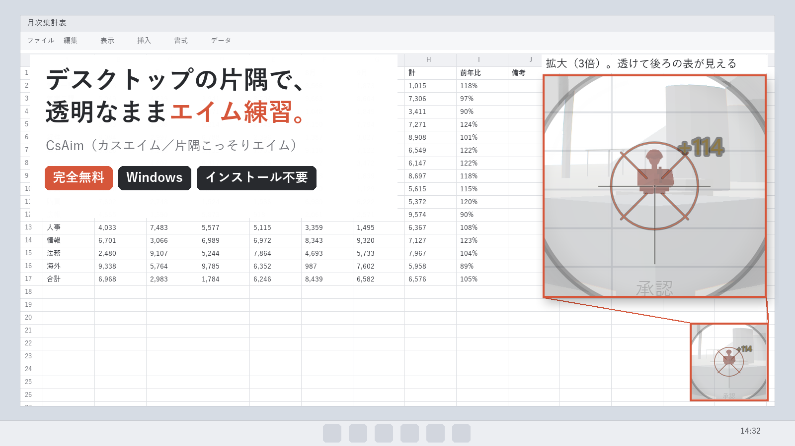
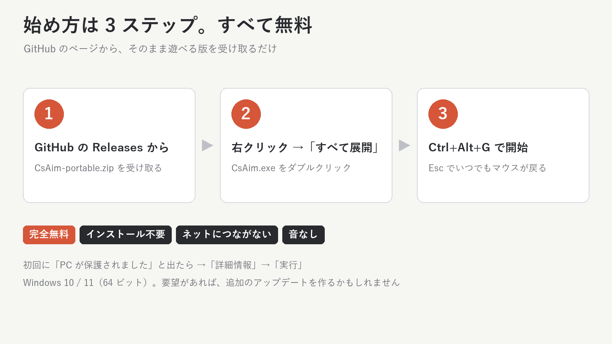
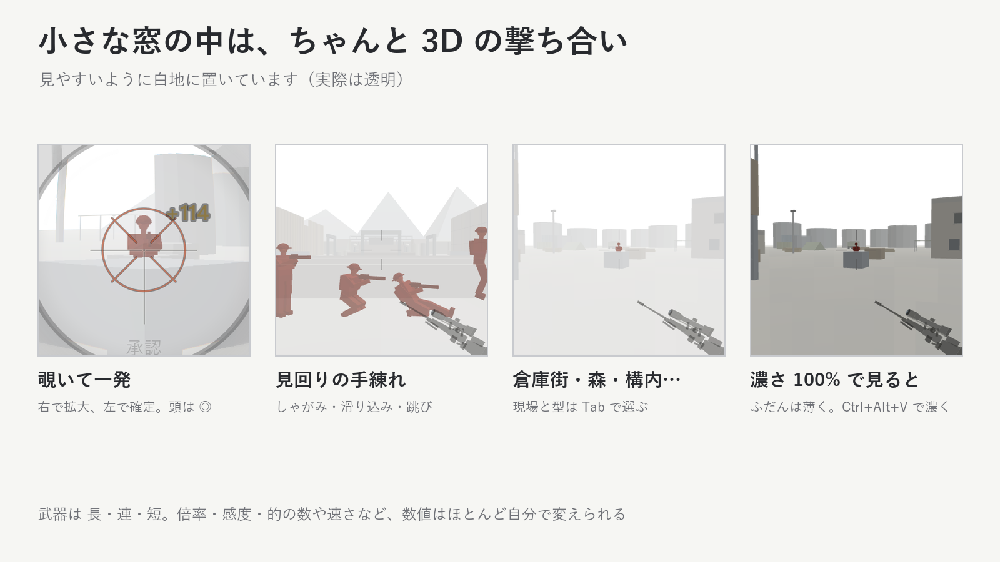
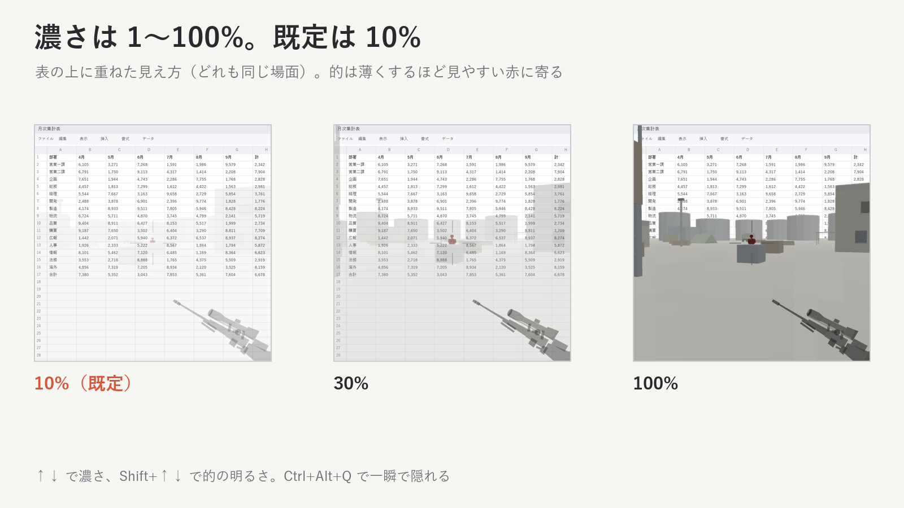

# CsAim（カスエイム／片隅こっそりエイム）

**デスクトップの片隅で、透明なままエイム練習。**
練習は家でしかできない、と上達をあきらめていた人へ。仕事の画面の隅に 3.5cm 角くらいの小さな窓を置いて、休憩の合間に撃ち合えます。

## ⬇ ダウンロード（無料）

**[最新版をダウンロード（Releases）](../../releases/latest)** → `CsAim-portable.zip`

- 完全無料。広告も課金もありません
- インストール不要。zip を展開して `CsAim.exe` を開くだけ
- ネットにはつながりません。音も出ません
- Windows 10 / 11（64 ビット）

## 始め方（3 ステップ）

1. [Releases](../../releases/latest) から `CsAim-portable.zip` を受け取る
2. zip を右クリック →「すべて展開」→ できた `CsAim` フォルダの `CsAim.exe` をダブルクリック
   - 初回に「Windows によって PC が保護されました」と出たら →「詳細情報」→「実行」
   - （署名のない個人制作のアプリなので出ます）
3. `Ctrl+Alt+G` で開始。`Esc` でいつでもマウスが戻ります

## どんなゲーム？

小さな窓の中は、ちゃんと 3D の撃ち合いです。

- **覗いて一発**: 右クリックで拡大、左で確定。頭に当てると ◎
- **見回りモード**: 歩いて走って、角から出てくる的を撃つ。半分は「手練れ」で、角をのぞき込み、しゃがみ、滑り込み、跳んで動きます
- **武器は 長・連・短**: ホイールで持ち替え
- **業務日報**: 今日の成績・最多日・累計を記録（このパソコンの中だけ）

## 濃さは自由

窓の濃さは 1〜100%（既定 10%）。`↑` `↓` で変えられます。的は薄くするほど見やすい赤に寄ります。
`Ctrl+Alt+Q` で一瞬で隠れ、もう一度で戻ります。

## 主なキー

| キー | 動作 |
|---|---|
| `Ctrl+Alt+G` | 開始（マウスを固定） |
| `Esc` | いつでもマウスを返す |
| 右クリック / 左クリック | 拡大 / 確定 |
| ホイール | 持ち替え（覗き中は倍率） |
| `Tab` | 現場選び |
| `↑` / `↓` | 濃さ |
| `Ctrl+Alt+Q` | すぐ隠す（もう一度で戻す） |
| `Ctrl+Alt+V` | 一時的に濃く |
| `Ctrl+Alt+X` | 終わる |

`Ctrl+Alt+` の近道はキー一覧の窓から変えられます。トレイのアイコンからも全部の操作ができます。

## 消し方

`CsAim` フォルダを消すだけ。設定と記録も消すなら `%APPDATA%\CsAim` も消してください。

## 要望

追加のアップデートは、いただいた要望に応えて作るかもしれません。X のリプライや DM でどうぞ。

## 注意

- 画面の読み取り・キー入力の記録・通信はしません
- 職場のルールは守って、休憩時間に遊んでください
